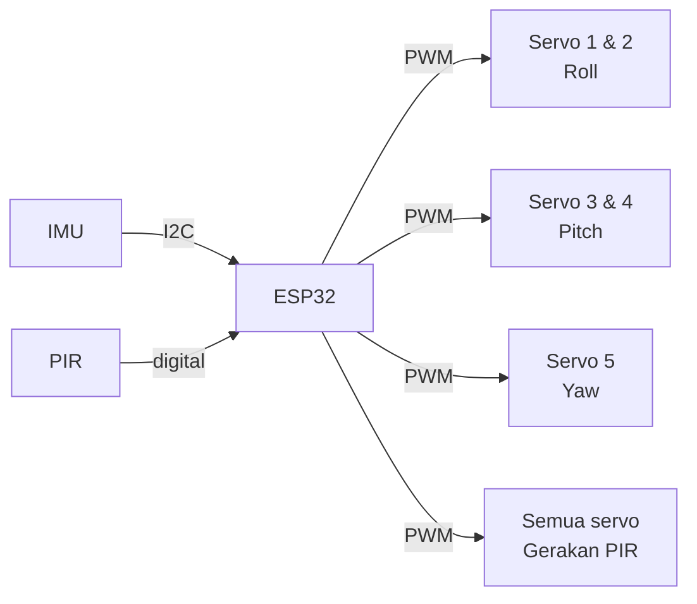
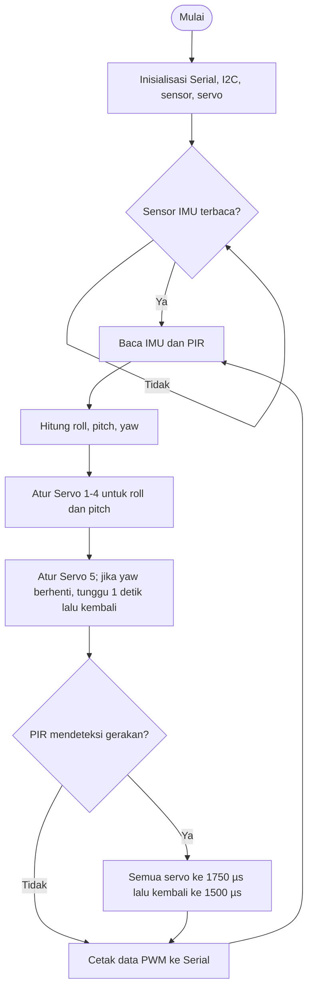

Rafa Attamimi Adnan Atmaja 

23/561854/PA/23689

Magang Day 3 GMRT

---

Disini terdapat sebuah program arduino yang membaca kemiringan dan gerakan, serta mengendalikan lima servo. Sensor yang digunakan adalah Adafruit_MPU6050 dan PIR Motion Sensor.

Menggunakan MPU6050 instead of BNO055 karena di Wokwi tidak terdapat BNO055, sehingga dipilih yang serupa

## Feature Table

| Fitur | Input (Sensor) | Output (Aktuator) | Perilaku |
|---|---|---|---|
| Roll | MPU6050 (IMU) | Servo 1 dan 2 | Kalau alat miring ke satu arah, kedua servo bergerak ke arah sebaliknya. |
| Pitch | MPU6050 (IMU) | Servo 3 dan 4 | Kedua servo bergerak mengikuti arah kemiringan alat. |
| Yaw | MPU6050 (IMU) | Servo 5 | Servo mengikuti putaran alat. Saat putaran berhenti, tunggu 1 detik lalu kembali ke posisi 0°. |
| Gerakan eksternal | Sensor PIR | Semua servo | Saat PIR mendeteksi gerakan, semua servo bergerak ke posisi yang ditentukan, lalu kembali ke posisi awal. |

## Diagram Blok

Gambaran besarnya gampang: dua sensor masuk ke ESP32, lalu ESP32 yang ngatur kelima servo.

## Flowchart

Alurnya gini: ESP32 baca sensor, ngitung sudutnya, gerakin servo, cek PIR, terus ulang dari awal.

## How to Run
1. Buka `main.ino` di Arduino IDE atau import project ke Wokwi.
2. Add library ESP32Servo dan Adafruit MPU6050.
3. Hubungkan komponen sesuai bagian pin di kode, dan sambungkan IMU ke jalur I2C (ESP32 21 dan 22).
4. Jalankan simulasi 
5. Ubah input sensor untuk mensimulasikan gerakan.

